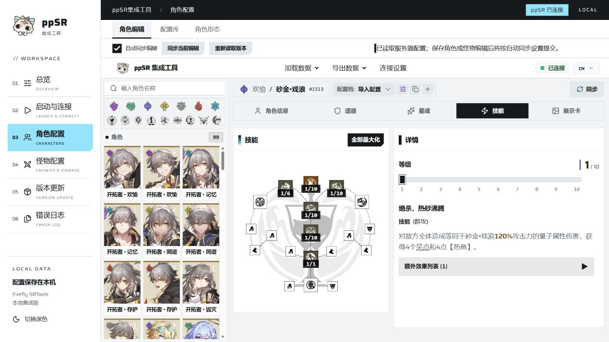
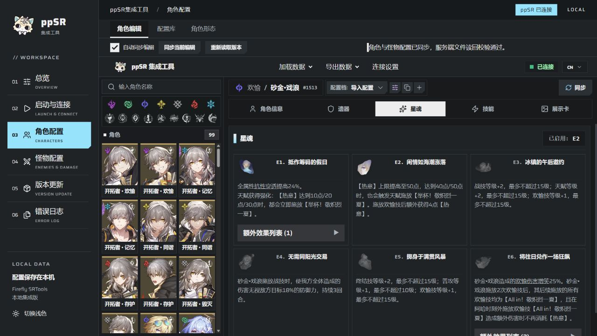
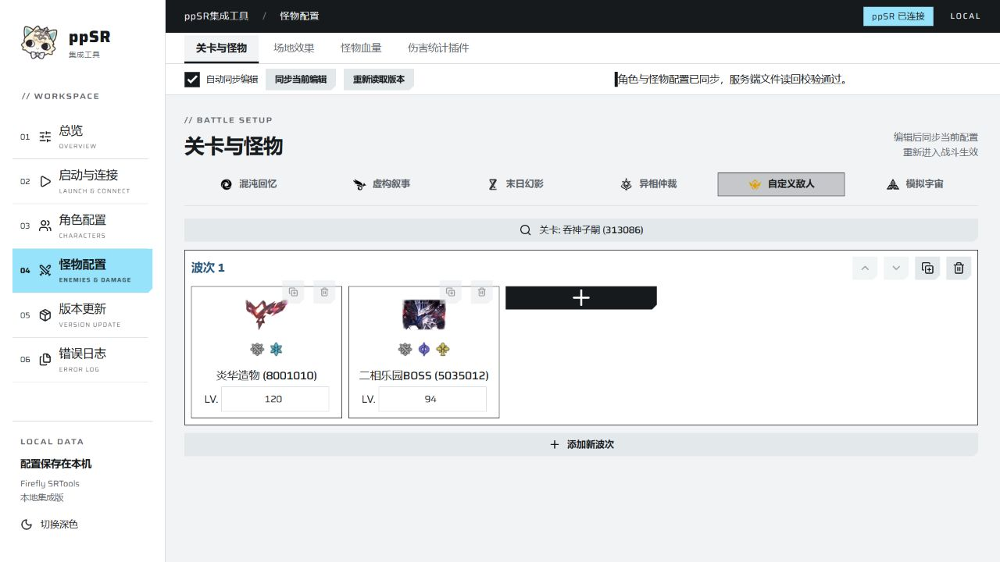
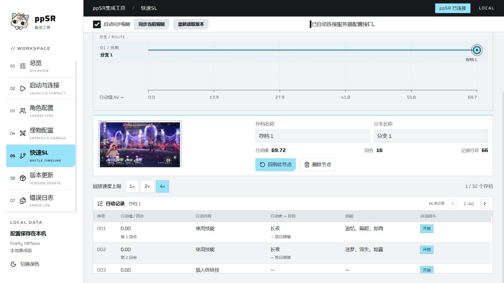
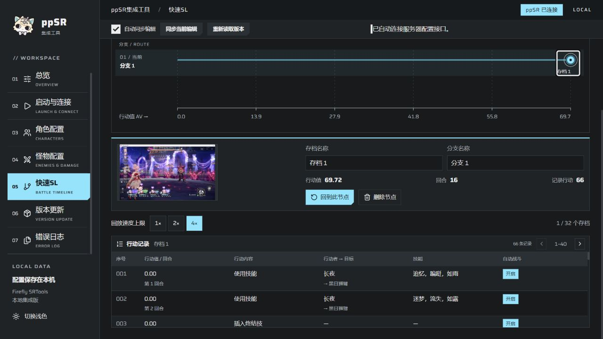

# ppSR集成工具

在一个窗口里完成角色配装、关卡与怪物配置、服务端和客户端启动。想比较不同的战斗操作时，可以用快速 SL 保存节点、回到节点，再尝试另一种选择。

**Windows 10 / 11 · 64 位 · 当前版本 1.0.1 · 浅色 / 深色主题**

[下载安装包](https://github.com/Tangdusama/ppsr-integrated-tool/releases/latest) · [查看 1.0.1 更新内容](https://github.com/Tangdusama/ppsr-integrated-tool/releases/tag/v1.0.1) · [反馈问题](https://github.com/Tangdusama/ppsr-integrated-tool/issues)

## 角色配置：配装与技能集中调整

角色编辑功能内置于软件，素材下载完成后即可在本地使用，无需另外打开 srtool 网站。1.0.1 已补充 4.7.51 的艾莲、耀嘉音及专属光锥，并提供本地技能、星魂与图片资料。

- **角色与光锥**：调整角色等级、终结技能量、秘技开关、光锥等级与叠影；支持相应角色的强化形态设置；有专属效果的角色会显示对应名称的开关。

- **遗器**：编辑套装、主属性、副属性与等级。可一次更换内圈两件套或外圈四件套；等级既能用常用滑条调整，也能直接输入整数。

- **技能与星魂**：查看中文说明、调整行迹等级与星魂。较长的说明可滚动阅读。

- **角色形态**：切换三月七的存护 / 巡猎形态，以及主角性别和已支持的命途。可用形态取决于对应服务端与客户端版本。新版服务端未提供在线切换接口时，关闭游戏和服务端后应用，再重新启动。

*角色列表、技能树和说明放在同一页，修改时可直接查看对应效果。*

*星魂按卡片排列，启用状态与说明分别展示；软件可切换浅色、深色主题。*

## 怪物配置：关卡、波次与血量一起管理

可选择已有的混沌回忆、虚构叙事、末日幻影、异相仲裁等关卡，也可使用自定义敌人，选择 Stage ID 后编辑每一波的怪物和等级。

- **自定义血量**：按已配置怪物选择修改目标，支持设置为 10 亿血量；输入范围为 1–4,294,967,295，更新服务端后无需重新登记。修改后重新进入战斗生效。

- **场地效果**：正面、负面效果分开选择，支持搜索与全选当前范围。目录收录王棋 / 骑士相关效果，不包含虚构、末日和贪饕侵蚀。部分效果需要对应关卡或怪物机制才能触发。

- **伤害统计插件**：提供添加与移除入口，方便打桩测试时记录结果。

*按波次排列敌人，怪物图片、编号与等级集中显示。截图为演示配置，实际可用内容以所用客户端和服务端为准。*

## 快速 SL：从保存的回合再试一次

当前回放模块尚未适配 4.7.51 客户端，加载可能提示 SF-REPLAY-032；普通启动和配置编辑不受此限制。

在角色正常可操作回合保存节点。需要重试时，选中节点，让游戏从本场战斗开始按记录加速重放，到达节点后继续操作。回放速度可选 1×、2×、4×；实际等待时间与节点之前的战斗长度有关。

时间线以行动值排列存档。点击节点后，下方显示当时的战斗截图、行动值、回合和记录数量；存档与分支都能命名，方便区分不同打法。

*开发测试期间的实机截图（2026-10-29）：选中节点后，可查看战斗截图、行动值、回合和记录行动数，并在下方选择回放速度。*

*同一场战斗的深色界面。行动记录逐条显示行动内容、行动者与目标、技能及自动战斗状态，较长的记录可以翻页查看。*

1. 通过工具一键启动，进入战斗后打开“快速SL”。
2. 关闭自动战斗，在正常回合保存节点。自动战斗、终结技和额外回合中不能保存。
3. 点击节点查看截图和记录，再选择回档；行动、随机数和落点状态会逐项核对。
4. 回档后继续战斗并尝试不同选择，形成新的分支。删除节点会一并删除依赖它的后续节点。

节点仅适用于当前战斗，更换角色、怪物或场地配置后重新挑战。目标模式包括混沌回忆、虚构叙事、末日幻影、异相仲裁和自定义关卡。复杂机制仍可能出现存档失败、回放中止或动画卡停；请在“错误日志”导出 ZIP，并在 Issues 中附上队伍、关卡和复现步骤。

## 保存配置，连接后同步

配置库可以保存已经编辑的方案，也能导入已有的 `freesr-data.json` 配置。角色、怪物与关卡的调整保存在本机，重新打开软件可恢复草稿。

连接设置同时提供自动设置与手动填写。启用“自动同步编辑”后，保存角色或怪物配置会提交到已连接的服务端；也可以使用顶部“同步当前编辑”手动提交。同步结果会在页面上显示。

srtool 资料更新只更新可选角色、怪物、关卡和相关说明，不替换你已经保存的配装与战斗配置。上游移除的历史条目默认保留，可在更新页面选择清理；仍被配置引用的条目会保留。

## 启动与更新

| 功能 | 用法 |
| --- | --- |
| 安装目录识别 | 自动扫描本地磁盘，跳过无权读取的位置；也可手动选择服务端和客户端目录。扫描会排除官方客户端，并检查所需文件；新版组件不再受旧哈希限制。 |
| 一键启动 | 保存目录后启动服务端与游戏，随后尝试连接配置接口；本地界面端口冲突时自动避让；首次登录在客户端内完成；启用“记住测试账号”后，后续只需点击“进入游戏”。 |
| ppSR 与客户端更新 | 在 Discord 更新来源完成登录后读取公告，进入下载链接按实际文件名识别更新。客户端 HDIFF 按匹配版本的补丁链依次升级，下载站过载时保留已下载文件。 |
| 服务器密码 | 从配置的 Discord password 频道读取并在本机加密保存；启动时尝试使用本地密码，过期时提示更新。 |
| srtool 更新 | 检查 Firefly 网站资料与仓库历史，补查间隔版本的角色、怪物和关卡变化。 |
| 软件更新 | 启动时检查 GitHub 新版本，也可手动检查。选择“此版本不再提示”后，只忽略当前候选版本。 |
| 更新进度 | 显示当前处理阶段；下载显示速度，可计量阶段显示进度和预计剩余时间。 |
| 错误日志 | 按错误代码查看原因，导出 ZIP，包含普通错误与快速 SL 失败诊断。 |

## 下载与首次使用

两种安装包功能相同，都内置运行环境，无需另装 Python、Node 或其他开发工具。

| 安装包 | 大小 | 适合情况 |
| --- | --- | --- |
| [轻量版 Online](https://github.com/Tangdusama/ppsr-integrated-tool/releases/download/v1.0.1/ppSR-Integrated-Tool-1.0.1-Online-Setup-x64.exe) | 约 453 MB | 安装后首次启动联网下载约 1.49 GB 图片素材，支持暂停、续传与重试。 |
| [完整安装包](https://github.com/Tangdusama/ppsr-integrated-tool/releases/download/v1.0.1/ppSR-Integrated-Tool-1.0.1-Setup-x64.exe) | 约 1.93 GB | 已包含图片素材，首次使用不需要另行下载素材。 |

1. **安装工具**，轻量版先完成首次素材下载。不要安装到游戏目录内。

2. 打开 **“启动与连接”**，扫描或手动选择已经准备好的服务端和客户端，保存路径后重启工具。

3. **启动服务端与游戏**，在游戏内完成登录，确认工具显示已连接。

4. 在 **“角色配置”与“怪物配置”** 中编辑，保存并同步后重新进入战斗。

安装包不包含游戏客户端和 ppSR 服务端，需要自行准备兼容版本。使用 Discord 更新来源时需自行登录；下载软件安装包和软件更新不需要 GitHub 账号。

已有 **1.0.0 / 0.3.4** 的用户，可在 **“版本更新 → 软件更新”** 升级到 1.0.1，更新包同时补齐快速 SL 运行组件。保存编辑后按提示安装并正常退出，下次打开使用新版。配置档、草稿和设置会保留；已经安装且校验一致的图片素材继续使用，不重复下载全套图片。`update.zip` 由工具自动处理，不用于首次安装。

软件更新会校验签名与文件哈希。轻量版下载较慢时，可直接选择完整安装包。向其他玩家分享时，请发送发布页的安装包，不要发送自己已经使用过的整个安装目录。

## 测试反馈

遇到问题可在 [Issues](https://github.com/Tangdusama/ppsr-integrated-tool/issues) 中说明软件版本、客户端与服务端版本、操作步骤、预期结果和实际结果，并附上截图或错误代码。需要日志时，在“错误日志”中导出 ZIP；提交前检查并移除个人路径、密码等敏感内容。

## 致谢

本地编辑功能基于 [Firefly SRTools](https://www.srtoos.fun/)，资料导航链接至 [Nanoka](https://nanoka.cc/)。游戏图片、文本、伤害统计插件和其他组件的版权归各自作者所有，组件许可证随安装包提供。本项目用于工具发布，与游戏官方无关联。

