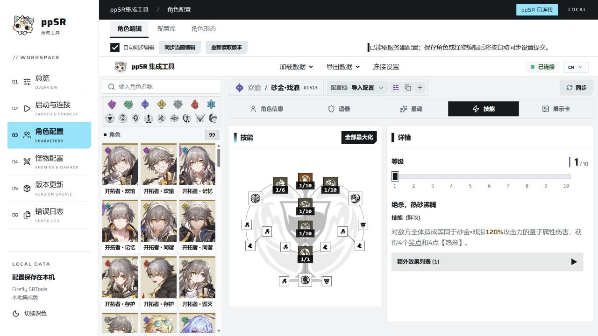
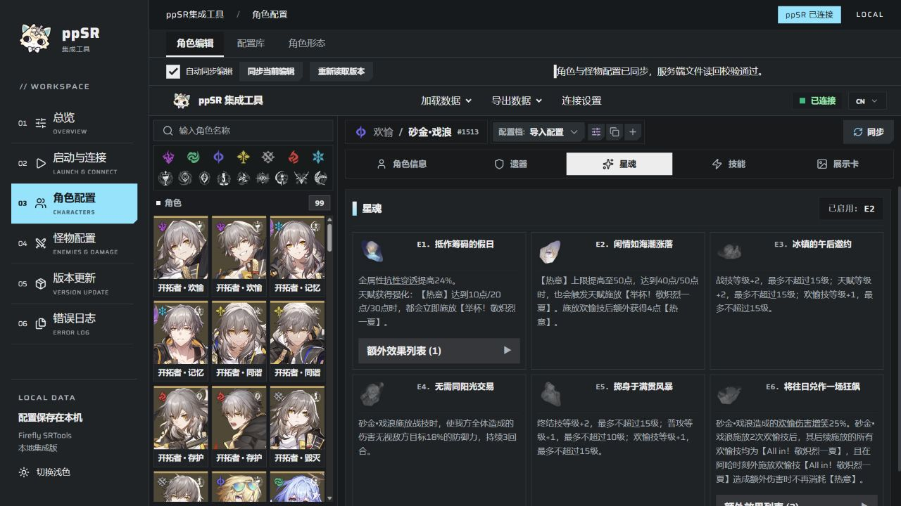
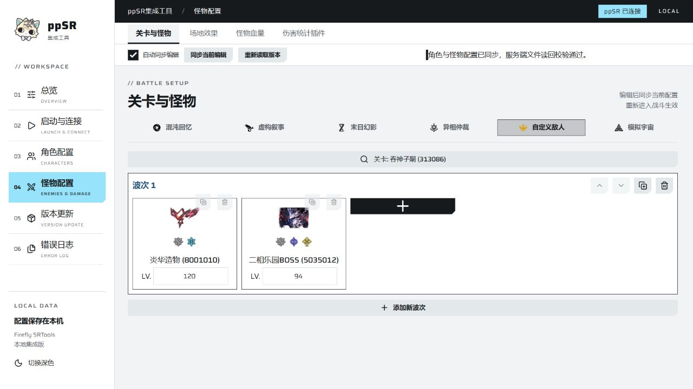

# ppSR集成工具

把角色配装、怪物配置、服务端启动和版本更新放在一个窗口里，方便准备战斗、调整数值和做伤害测试。

**Windows 10 / 11 · 64 位 · 当前版本 0.3.3 · 浅色 / 深色主题**

[下载安装包](https://github.com/Tangdusama/ppsr-integrated-tool/releases/latest) · [查看 0.3.3 更新内容](https://github.com/Tangdusama/ppsr-integrated-tool/releases/tag/v0.3.3) · [反馈问题](https://github.com/Tangdusama/ppsr-integrated-tool/issues)

## 角色配置：配装与技能集中调整

角色编辑功能内置于软件，素材下载完成后即可在本地使用，无需另外打开 srtool 网站。

- **角色与光锥**：调整角色等级、终结技能量、秘技开关、光锥等级与叠影；支持相应角色的强化形态设置。
- **遗器**：编辑套装、主属性、副属性与等级。可一次更换内圈两件套或外圈四件套；等级既能用常用滑条调整，也能直接输入整数。
- **技能与星魂**：查看中文说明、调整行迹等级与星魂。较长的说明可滚动阅读。
- **角色形态**：切换三月七的存护 / 巡猎形态，以及主角性别和已支持的命途。可用形态取决于对应服务端与客户端版本。

*角色列表、技能树和说明放在同一页，修改时可直接查看对应效果。*

*星魂按卡片排列，启用状态与说明分别展示；软件可切换浅色、深色主题。*

## 怪物配置：关卡、波次与血量一起管理

可选择已有的混沌回忆、虚构叙事、末日幻影、异相仲裁等关卡，也可使用自定义敌人，选择 Stage ID 后编辑每一波的怪物和等级。

- **自定义血量**：按已配置怪物选择修改目标，支持设置为 10 亿血量；输入范围按当前已核验的服务端限制检查。修改后重新进入战斗生效。
- **场地效果**：正面、负面效果分开选择，支持搜索与全选当前范围。目录收录王棋 / 骑士相关效果，不包含虚构、末日和贪饕侵蚀。部分效果需要对应关卡或怪物机制才能触发。
- **伤害统计插件**：提供添加与移除入口，方便打桩测试时记录结果。

*按波次排列敌人，怪物图片、编号与等级集中显示。截图为演示配置，实际可用内容以所用客户端和服务端为准。*

## 保存配置，连接后同步

配置库可以保存已经编辑的方案，也能导入已有的 `freesr-data.json` 配置。角色、怪物与关卡的调整保存在本机，重新打开软件可恢复草稿。

连接设置同时提供自动设置与手动填写。启用“自动同步编辑”后，保存角色或怪物配置会提交到已连接的服务端；也可以使用顶部“同步当前编辑”手动提交。同步结果会在页面上显示。

srtool 资料更新只更新可选角色、怪物、关卡和相关说明，不替换你已经保存的配装与战斗配置。上游移除的历史条目默认保留，可在更新页面选择清理；仍被配置引用的条目会保留。

## 启动与更新

| 功能 | 用法 |
| --- | --- |
| 安装目录识别 | 自动扫描本地磁盘，跳过无权读取的位置；也可手动选择服务端和客户端目录。扫描会排除官方客户端，并核验兼容组件。 |
| 一键启动 | 保存目录后启动服务端与游戏，随后尝试连接配置接口；游戏登录在客户端内完成。 |
| ppSR 与客户端更新 | 在 Discord 更新来源完成登录后读取公告，下载对应更新包。客户端 HDIFF 按匹配版本的补丁链依次升级。 |
| 服务器密码 | 从配置的 Discord password 频道读取并在本机加密保存；启动时尝试使用本地密码，过期时提示更新。 |
| srtool 更新 | 检查 Firefly 网站资料与仓库历史，补查间隔版本的角色、怪物和关卡变化。 |
| 软件更新 | 启动时检查 GitHub 新版本，也可手动检查。选择“此版本不再提示”后，只忽略当前候选版本。 |
| 更新进度 | 显示当前处理阶段；下载显示速度，可计量阶段显示进度和预计剩余时间。 |
| 错误日志 | 按错误代码查看原因，并导出 TXT 便于反馈。 |

## 下载与首次使用

两种安装包功能相同，都内置运行环境，无需另装 Python、Node 或其他开发工具。

| 安装包 | 大小 | 适合情况 |
| --- | --- | --- |
| [轻量版 Online](https://github.com/Tangdusama/ppsr-integrated-tool/releases/download/v0.3.3/ppSR-Integrated-Tool-0.3.3-Online-Setup-x64.exe) | 约 296 MB | 安装后首次启动联网下载约 1.49 GB 图片素材，支持暂停、续传与重试。 |
| [完整安装包](https://github.com/Tangdusama/ppsr-integrated-tool/releases/download/v0.3.3/ppSR-Integrated-Tool-0.3.3-Setup-x64.exe) | 约 1.77 GB | 已包含图片素材，首次使用不需要另行下载素材。 |

1. **安装工具**，轻量版先完成首次素材下载。不要安装到游戏目录内。
2. 打开 **“启动与连接”**，扫描或手动选择已经准备好的服务端和客户端，保存路径后重启工具。
3. **启动服务端与游戏**，在游戏内完成登录，确认工具显示已连接。
4. 在 **“角色配置”与“怪物配置”** 中编辑，保存并同步后重新进入战斗。

安装包不包含游戏客户端和 ppSR 服务端，需要自行准备兼容版本。使用 Discord 更新来源时需自行登录；下载软件安装包和软件更新不需要 GitHub 账号。

已有 **0.3.0-preview、0.3.1、0.3.2** 的用户，可在 **“版本更新 → 软件更新”** 升级到 0.3.3，更新包约 11.2 MB。保存编辑后按提示安装并正常退出，下次打开使用新版。配置档、草稿和设置会保留；普通软件更新不会重复下载全套图片。`update.zip` 由工具自动处理，不用于首次安装。

软件更新会校验签名与文件哈希。轻量版下载较慢时，可直接选择完整安装包。向其他玩家分享时，请发送发布页的安装包，不要发送自己已经使用过的整个安装目录。

## 测试反馈

遇到问题可在 [Issues](https://github.com/Tangdusama/ppsr-integrated-tool/issues) 中说明软件版本、客户端与服务端版本、操作步骤、预期结果和实际结果，并附上截图或错误代码。需要日志时，在“错误日志”中导出 TXT；提交前检查并移除个人路径、密码等敏感内容。

## 致谢

本地编辑功能基于 [Firefly SRTools](https://www.srtoos.fun/)，资料导航链接至 [Nanoka](https://nanoka.cc/)。游戏图片、文本、伤害统计插件和其他组件的版权归各自作者所有，组件许可证随安装包提供。本项目用于工具发布，与游戏官方无关联。
