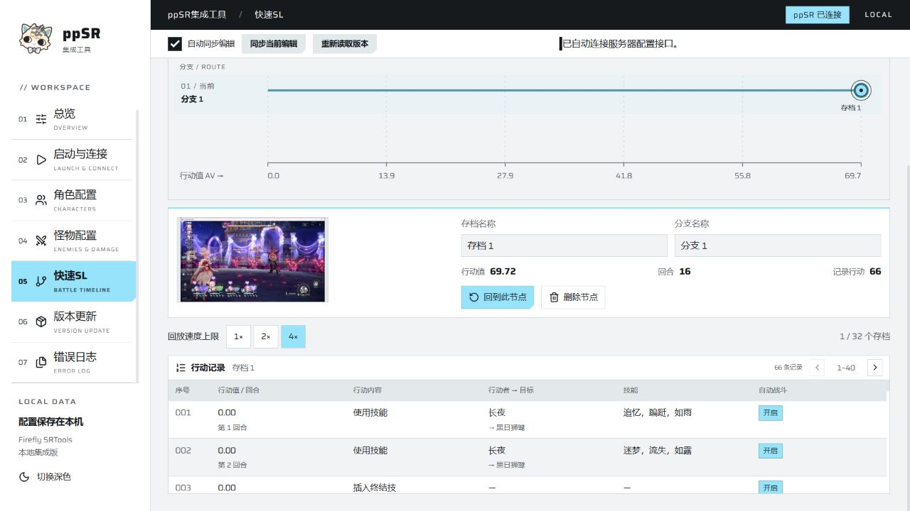
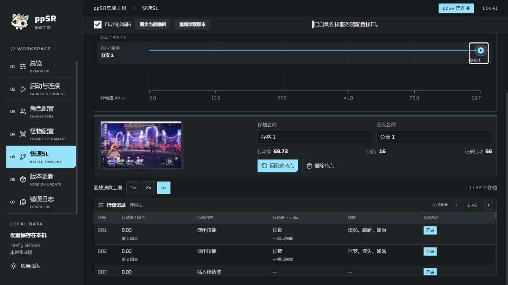

# ppSR集成工具 1.0.0

本版汇总 0.3.4 之后的本地更新，加入快速 SL、账号记忆与首次运行更新公告，并改进配置编辑、启动和诊断流程。

## 快速 SL

- 同一场战斗内保存节点，选择节点后从本场开头按记录加速重放，到达节点后继续战斗；速度可选 1×、2×、4×，等待时间与节点之前的战斗长度有关。
- 分支时间线按行动值排列，支持缩放、密集节点聚合、节点与分支命名、截图预览和行动明细。
- 自动战斗沿用客户端原生回放机制，角色、怪物及场地事件按顺序核验；对照行动、随机数、计数与节点状态。
- 支持目标模式为混沌回忆、虚构叙事、末日幻影、异相仲裁和自定义关卡。正常可操作回合才允许保存；自动战斗、终结技和额外回合中不能保存。
- 节点只用于当前战斗；更换角色、怪物或场地配置后重新挑战。删除节点会同时删除依赖它的后续节点与分支。
- 回放或保存失败可在“错误日志”导出 ZIP，包含对应诊断记录，方便反馈。

*开发测试期间的实机截图（2026-10-29）。选中存档后可查看截图、行动值、回合与行动明细，并选择回放速度。*

## 启动、配置与更新

- 准备启动页新增“记住测试账号”开关。首次完成登录后，后续启动只需点击“进入游戏”。
- 客户端按 1920 × 1080 窗口启动，改进窗口启动组件的结果检查与报错。
- 改进 Cipher 密码公告解析、密码写入及一键启动衔接。
- 修复配置档并发保存误报，改善角色与怪物保存后的自动同步。
- 补齐快捷更换遗器套装列表，统一搜索提示词，改善默认窗口下的下拉菜单与控件显示，兼顾浅色和深色主题。
- 首次安装或升级后显示本版公告，确认后不重复弹出；可在“版本更新 → 软件更新”再次查看。
- 错误日志从 TXT 导出改为 ZIP 导出，同时收录快速 SL 失败记录。

## 使用与反馈

新用户选择 Online 轻量安装包或完整安装包。已有用户在“版本更新 → 软件更新”下载并安装，保存编辑后正常退出工具即可完成升级。角色配置、怪物配置、草稿和设置保留。

快速 SL 在复杂队伍与关卡中仍可能出现存档失败、回放中止或动画卡停。遇到问题请结束当前重放，导出错误日志，在 [GitHub Issues](https://github.com/Tangdusama/ppsr-integrated-tool/issues) 附上客户端和服务端版本、队伍、关卡及复现步骤。

## 作者的话

为了减少afsg的重开次数所以特地开发了快速SL功能，但此功能在开发过程中表现得非常不稳定，作者一个人实在没有精力测试所有队伍和所有关卡。如果大家在使用此功能的过程中遇到了bug，希望能在github上反馈一下，这对本功能的维护与开发非常有帮助。感谢各位！
